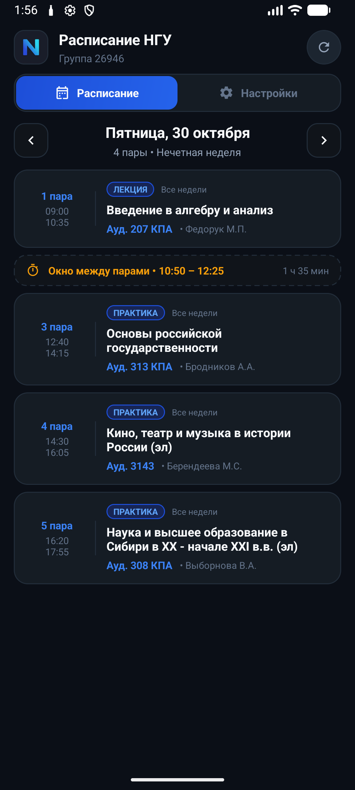
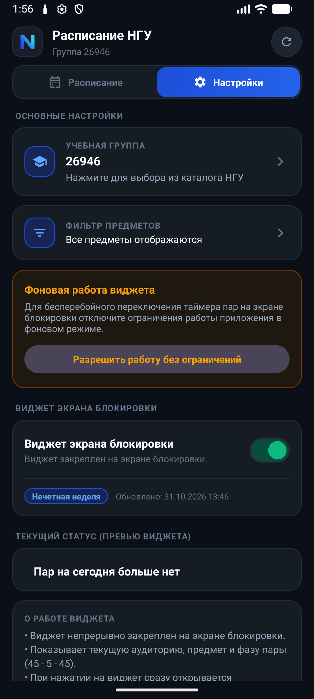
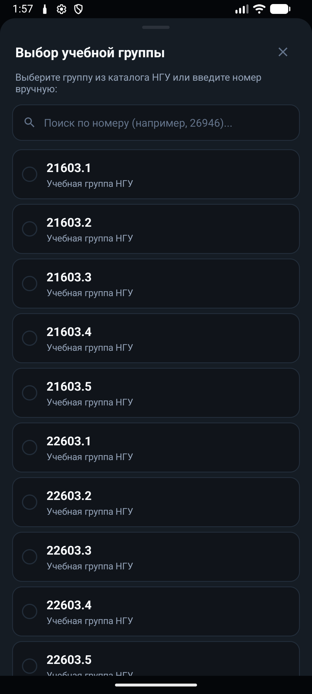

# NSU Schedule Widget

Android-приложение и постоянный виджет экрана блокировки с расписанием занятий для студентов Новосибирского государственного университета (НГУ).

---

## Основные возможности

- **Виджет на экране блокировки:** Закреплённое уведомление с динамическим обратным отсчётом до начала или конца текущей пары с учётом микрофаз (45 мин — перерыв 5 мин — 45 мин).
- **Расписание на всю неделю:** Быстрое переключение дней свайпами или стрелками, бейдж «Сегодня», автоматическое определение чётности недели и отображение окон между парами.
- **Удобная компоновка (Zero Scroll):** Все пары дня (даже при 5 парах с окнами) сразу видны на одном экране без лишней прокрутки.
- **Вкладка «Настройки»:** Выбор любой учебной группы из каталога НГУ с поиском, фильтр отображаемых предметов, переключатель виджета и его живое превью с таймером.
- **Встроенные обновления (OTA):** Проверка и установка новых версий прямо из приложения в один клик.
- **Dark Slate UI:** Глубокая тёмная палитра в едином стиле (#0F141C / #18202A / #1E2734).

---

## Скриншоты

  
  &nbsp;&nbsp;
  
  &nbsp;&nbsp;
  

---

## Установка

1. Перейдите в раздел [**Releases**](https://github.com/h1xen/NSU-Schedule-Widget/releases/latest) и скачайте актуальный файл **`NSU_Schedule_v1.2.1.apk`**.
2. Откройте скачанный APK на смартфоне и подтвердите установку (разрешите установку из неизвестных источников, если система запросит).
3. При первом запуске:
   - Выберите вашу группу в каталоге НГУ;
   - Включите переключатель **«Виджет экрана блокировки»**;
   - Для бесперебойной работы таймера на экране блокировки отключите оптимизацию батареи для приложения по кнопке в настройках.

---

## Технологический стек

- **Язык:** Kotlin 100%
- **Архитектура и компоненты:** Single Activity, View Binding, Material Design 3, Coroutines, WorkManager, ViewPager2
- **Парсер расписания:** Jsoup (HTML-парсинг официального расписания `table.nsu.ru`)
- **Службы:** Foreground Service (`specialUse`), AlarmManager Exact Alarms, BroadcastReceiver (Boot/Time Change)
- **Безопасность:** Network Security Config (принудительный TLS/HTTPS, отключён cleartext HTTP)

---

## Лицензия

Распространяется свободно для студентов и преподавателей НГУ.
